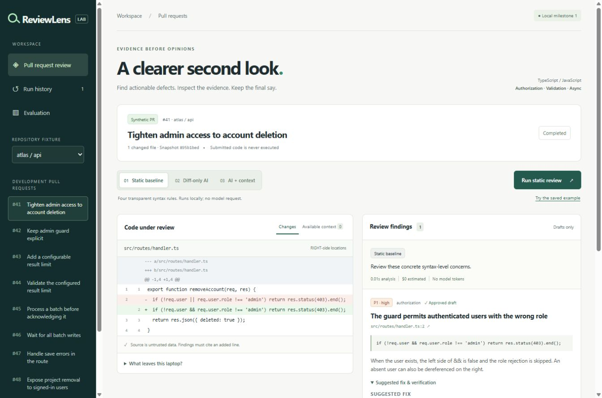

# Gowtham Reddy — software engineering & applied AI

**[Explore the portfolio](https://gowthamreddy-ch.github.io/)** · [Résumé](https://gowthamreddy-ch.github.io/assets/Gowtham_Reddy_Resume.pdf) · [GitHub profile](https://github.com/gowthamreddy-ch)

Working projects in full-stack engineering, recommendation systems, and AI evaluation. Each case study explains the problem, implementation, recorded results, and limitations.

[](https://gowthamreddy-ch.github.io/projects/reviewlens/)

## Explore the work

| Project | Focus | Evidence |
| --- | --- | --- |
| [ReviewLens](https://gowthamreddy-ch.github.io/projects/reviewlens/) | Static and AI code review with changed-line evidence and human-approved drafts. | Synthetic development comparison, false-positive analysis, and recorded results. |
| [ReelLab](https://gowthamreddy-ch.github.io/projects/reellab/) | Personalized movie recommendations and editable taste profiles. | MovieLens 100K evaluation against popularity, including a three-rating experiment. |
| [FindWise](https://gowthamreddy-ch.github.io/projects/findwise/) | Product discovery, explicit filters, comparison, and persistent carts. | API validation, baseline relevance results, and desktop/mobile screenshots. |
| [Evidence Lab](https://gowthamreddy-ch.github.io/projects/evidence-lab/) | Feedback analysis, incident triage, and reviewed network recovery. | Recorded synthetic evaluations and simulated-lab checks. |

These are case studies of local working prototypes. The portfolio hosts public screenshots, résumé, and evaluation evidence; the backend applications are not running on GitHub Pages.

## Application repositories

- **[Handshake Career Lab](https://github.com/gowthamreddy-ch/handshake-career-lab)** — React/TypeScript and ASP.NET Core internship workflows. [Try the browser-only demo](https://gowthamreddy-ch.github.io/handshake-career-lab/).
- **[Bloodline](https://github.com/gowthamreddy-ch/bloodline-django)** — Django donor booking and blood-bank operations, with role checks, inventory transitions, and audit history. Synthetic-data local demo.

## About this repository

This repository is the publishing copy of the portfolio. Working application source, databases, credentials, and local runtimes are not included.

GitHub Pages serves `docs/` from the `main` branch. `.nojekyll` preserves the
generated static files. Links are relative so project and account sites work.
The live backend projects require separate hosting; the public case studies
offer screenshots, evidence and a contact link for demonstrations.

## Updating

With Node.js 22 or later, create an ignored `publish-config.local.json` containing
`{"source":"absolute path to the reviewed portfolio dist directory"}`. Run:

```sh
node scripts/prepare-pages.mjs
node scripts/check-pages.mjs
```

Review `git diff` before committing. Upload only the allowlisted public assets.
Never place API keys, backend source, databases or dependency folders in `docs/`.
The HTML, CSS and browser JavaScript used to display any public website are
necessarily accessible to its visitors. No application-source download is offered.
